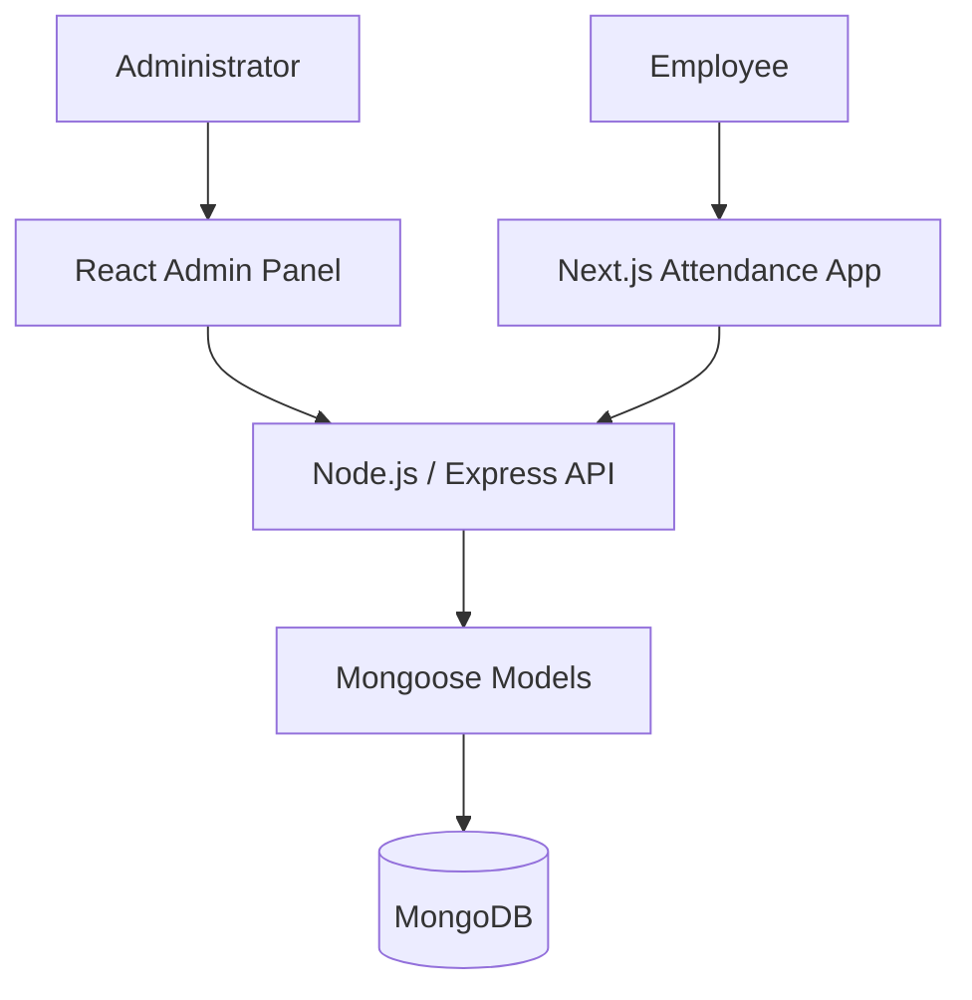

<!--
  HRMS — Human Resource Management System
  Documentation refreshed for clarity. Feature and setup claims are limited
  to information currently documented in this repository.
-->

<div align="center">

# HRMS — Human Resource Management System

**A web-based platform for organizing core human-resource workflows.**

An academic major project exploring administration, attendance, leave management,
and employee-facing workflows through a multi-frontend application.

<br />


</div>

---

## Table of Contents

- [Overview](#overview)
- [What the Project Covers](#what-the-project-covers)
- [Application Architecture](#application-architecture)
- [Technology Stack](#technology-stack)
- [Repository Layout](#repository-layout)
- [Data Model](#data-model)
- [Installation](#installation)
- [Configuration](#configuration)
- [Running the Applications](#running-the-applications)
- [How to Use](#how-to-use)
- [Development Status and Limitations](#development-status-and-limitations)
- [Security Notes](#security-notes)
- [License](#license)

## Overview

The **Human Resource Management System (HRMS)** is designed to bring common
HR activities into one web-based workspace. The project is organized around
three parts:

1. **Backend API** — a Node.js and Express service intended to handle application
   requests and persist data in MongoDB.
2. **Admin panel** — the main React-based interface for administrative workflows.
3. **Attendance application** — a separate Next.js interface for attendance-related
   interactions.

The goal is to provide a clear foundation for managing employee-related
information and day-to-day HR processes. This is an academic development
project and is still evolving; not every screen currently represents a
fully connected, production-ready workflow.

## What the Project Covers

The current project documentation describes the following areas:

| Area | Purpose | Current implementation note |
|---|---|---|
| Admin dashboard | Overview of HR activity and dashboard information | Some dashboard content uses demonstration data |
| Employee information | View and manage employee-related information | Employee entries are currently documented as sample UI data |
| Attendance | Punch-in, punch-out, and attendance history | Backend API integration is documented |
| Leave management | Submit and review leave requests | Backend API integration is documented |
| Payroll | Payroll-related interface | Demonstration UI data; verify integration before relying on it |
| Reports | HR reporting interface | Verify data integration |
| Settings | Application settings interface | Verify data integration |
| Attendance frontend | Separate interface for attendance workflows | Implemented as a Next.js application according to the project documentation |

> **Important:** A visible screen does not necessarily mean its data is stored in
> MongoDB. The project currently contains a mixture of API-connected workflows
> and demonstration UI data.

## Application Architecture

The intended high-level flow is:



- The admin panel and attendance frontend communicate with the backend API.
- The backend uses Mongoose to work with MongoDB.
- The API is configured to use port `9000` by default.
- The attendance frontend is documented as using port `3001` by default.
- The admin frontend uses the development URL printed by Vite.

## Technology Stack

The following stack is described by the project documentation. Check the
application manifests when they are restored to confirm exact dependency versions.

| Component | Technologies |
|---|---|
| Admin frontend | React 18, Vite 5, React Router |
| UI | CSS, Tailwind CSS, Radix UI, Lucide icons, Recharts |
| Attendance frontend | Next.js 16, React 19, TypeScript, Tailwind CSS |
| Backend | Node.js, Express 5 |
| Database | MongoDB, Mongoose 9 |
| Configuration | dotenv and environment variables |

## Repository Layout

```text
HRMS-Human-Resource-Management-System/
├── backend/                 # Backend API and database layer
│   └── .env.example         # Backend configuration template
├── hrms-admin-panel/        # Main React + Vite admin interface
│   └── .env.example         # Admin frontend configuration template
├── att/                     # Next.js attendance interface
│   └── .env.example         # Attendance frontend configuration template
├── .gitignore
├── LICENSE
└── README.md
```

The public `main` branch currently contains the directory configuration
templates shown above, but **does not currently contain the application source
files or the `package.json` manifests**. This means a fresh clone of the public
branch is not yet sufficient to install and launch the applications. See
[Installation](#installation) before attempting setup.

## Data Model

The current documentation describes three Mongoose models:

| Model | Purpose | Documented fields |
|---|---|---|
| User | User account information | `name`, `email`, `password` |
| Attendance | Daily attendance records | `userId`, `userName`, `email`, `workMode`, `punchInTime`, `punchOutTime`, `date`, `totalDuration` |
| Leave | Leave requests | `userId`, `userName`, `email`, `leaveType`, `startDate`, `endDate`, `reason`, `status`, `appliedDate` |

These are model/field descriptions from the existing project documentation,
not a database export. No employee dataset or production database is included.

## Installation

### Prerequisites

When the application source is available, the documented stack requires:

- [Node.js](https://nodejs.org/) and npm
- [MongoDB Community Server](https://www.mongodb.com/try/download/community)
  running locally, or a MongoDB Atlas database
- Git

### 1. Clone the repository

```bash
git clone https://github.com/VectorArchitect/HRMS-Human-Resource-Management-System.git
cd HRMS-Human-Resource-Management-System
```

### 2. Check that the application files are present

Before installing dependencies, confirm that these files exist:

- `backend/package.json`
- `hrms-admin-panel/package.json`
- `att/package.json`

**Current public-repository limitation:** these package manifests and the
application source files are not present on the `main` branch at the time this
README was updated. Therefore, `npm install` cannot currently be completed
from a fresh clone of this branch. The source code must be added to the
repository first.

Do not create replacement package manifests just to make these commands run;
they must match the actual application code and dependencies.

## Configuration

Once the corresponding application files have been added, create a local
`.env` file in each application directory by copying its example.

**Backend — `backend/.env`**

```env
PORT=9000
MONGODB_URI=mongodb://127.0.0.1:27017/hrms_db
```

**Admin panel — `hrms-admin-panel/.env`**

```env
VITE_BASE_URL=http://localhost:9000
```

**Attendance app — `att/.env`**

```env
NEXT_PUBLIC_BASE_URL=http://localhost:9000
```

These values are templates for local development. Replace the MongoDB URI
with your own connection string when needed.

> Never commit real `.env` files. Only commit example templates with
> placeholder values. Do not put database credentials or private secrets in
> browser-exposed variables such as `VITE_*` or `NEXT_PUBLIC_*`.

## Running the Applications

The existing project notes describe the following development workflow.
Run these commands **only after the matching source files and package
manifests have been restored**. The relevant `package.json` must define
the `dev` script for `npm run dev` to work.

Open a separate terminal for each application.

**Terminal 1 — Backend API**

```bash
cd backend
npm install
npm run dev
```

The documented default backend port is `9000`.

**Terminal 2 — Admin panel**

```bash
cd hrms-admin-panel
npm install
npm run dev
```

Open the local Vite URL printed in the terminal.

**Terminal 3 — Attendance application (optional)**

```bash
cd att
npm install
npm run dev
```

The attendance application is documented as using port `3001`.

## How to Use

Once the applications are installed and running:

1. Start MongoDB and confirm that the backend can connect to it.
2. Start the backend API.
3. Start the admin panel and open the local URL shown by Vite.
4. Start the attendance application separately if you want to test its interface.
5. Use the available dashboard and workflow screens to explore the project.
6. Treat employee and payroll entries shown as sample/demo content as test data,
   not as real employee records.
7. Test attendance and leave operations against the configured backend.
   Their integration is documented, but each workflow should be verified
   in the running application.

No default username or password is published in this repository. Do not assume
there is a built-in demo account.

## Development Status and Limitations

This project is under active academic development.

- The codebase is documented as containing both API-backed features and
  demonstration UI data.
- Employee, payroll, and some dashboard/company entries are described as
  hardcoded sample data.
- User, Attendance, and Leave are the models described in the current docs.
- Attendance and leave API integration is documented; verify behavior locally.
- The public repository currently lacks the application source and package
  manifests required for a fresh installation.

As the source is added and modules are completed, this section should be
updated to distinguish implemented, tested, and planned functionality.

## Security Notes

This project should not be used with real employee information until its
security controls have been reviewed and strengthened.

Before any real-world deployment:

- Hash passwords using a suitable password-hashing algorithm.
- Implement secure authentication, session management, and role-based
  authorization on protected API routes.
- Restrict CORS to trusted frontend origins.
- Validate and sanitize incoming request data.
- Avoid returning internal stack traces or sensitive error details to clients.
- Store secrets outside source control and rotate any exposed credentials.
- Use synthetic employee records in screenshots and demonstrations.

## License

This project is distributed under the [MIT License](LICENSE).

---

<div align="center">

Made by **[VectorArchitect](https://github.com/VectorArchitect)**

</div>
